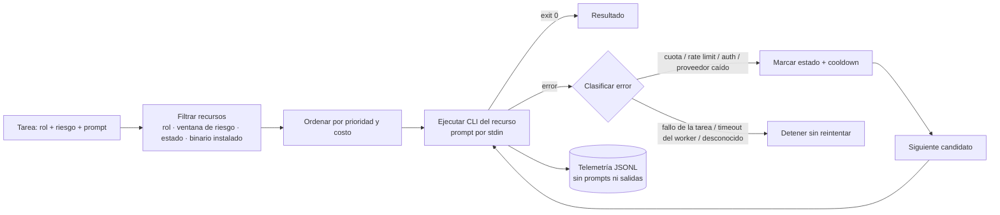

# VilTech AI Router

> A stdlib-only Python CLI that routes coding tasks across local AI CLIs (Codex, OpenCode, Antigravity) by role, risk and cost, failing over only on provider/quota errors — never on task failures.

**Estado:** MVP funcional

## Qué problema resuelve

Trabajo con varias CLIs de IA, cada una con cuotas, costos y modelos distintos. Elegir a mano cuál usar y cambiar de proveedor cuando uno se queda sin cuota es lento y propenso a errores. Este router elige automáticamente el recurso (adapter + modelo) adecuado para cada tarea. Además protege los modelos premium para que solo se usen en tareas de alto riesgo.

## Cómo funciona



Decisiones de diseño clave:

- **Granularidad por recurso (adapter + modelo), no por CLI.** Una misma CLI expone modelos con cuotas y riesgos distintos, así que el estado y el cooldown se llevan por modelo.
- **El failover ocurre solo ante fallas de infraestructura.** Si el error es de código o de tests, se detiene: reintentar con otro modelo ocultaría el problema real y gastaría cuota.
- **Las ventanas de riesgo protegen a los premium.** Las tareas low/medium nunca "se derraman" a modelos premium; las tareas high nunca bajan silenciosamente a un modelo más débil.
- **Privacidad por diseño.** El prompt se pasa por stdin (no por argv, que es visible en `ps`). En estado y telemetría solo se guardan nombre del recurso, categoría de error, duración y el nombre base del repo. La respuesta del agente se muestra solo en la terminal.
- **Repos sensibles.** Los repos de `sensitive_repos` (y sus worktrees), o cualquier repo con un archivo `.router-sensitive`, nunca se envían a recursos con `sensitive_ok = false`. Por ejemplo, modelos gratuitos que pueden guardar los prompts, o proveedores que no deben ver datos personales de alumnos o clientes.
- **Solo biblioteca estándar** (`tomllib`, `argparse`, `subprocess`, `unittest`), así que no hay dependencias que auditar.

## Qué funciona hoy

Requisitos: Python 3.11+ y, para `run`, al menos una de las CLIs `agy`, `opencode` o `codex` instalada y autenticada.

```bash
python -m viltech_ai_router inventory --config router.toml        # lista recursos y si su CLI está instalada
python -m viltech_ai_router status --config router.toml           # estado y cooldown por recurso
python -m viltech_ai_router route --role coder --risk low --config router.toml   # dry-run: qué elegiría y por qué
python -m viltech_ai_router state-reset --resource agy_flash --config router.toml
python -m viltech_ai_router run --prompt-file task.txt --repo-dir /ruta/al/repo --role coder --risk low --config router.toml
```

- `inventory`, `status`, `route` y `state-reset` están verificados.
- Tests: `python -m unittest discover -s tests -v` → **15/15 pasan**. Cubren routing por riesgo y costo, la forma de los comandos de cada CLI, la clasificación de errores (incluidos mensajes reales de opencode 1.19 y agy 1.4), los errores que una CLI reporta con código 0, la extracción de la respuesta, el candado de repos sensibles, la recuperación del cooldown, el failover, la privacidad de la telemetría y que no haya failover ante fallas de la tarea.
- **Probado con CLIs reales el 03-nov-2026** (codex-cli 0.165, opencode 1.19.5, agy 1.4.12):
  - `run` con Codex (`gpt-6.1-terra`, plan ChatGPT Plus) resolvió una tarea real: creó un archivo y su test y lo ejecutó.
  - Failover real: un modelo de una suscripción vencida (`opencode-go/…`, que OpenCode reporta como «Unexpected server error») quedó en `provider_down` con cooldown, y la tarea pasó a un modelo gratuito de OpenCode Zen.
  - Antigravity sin sesión iniciada devuelve `authentication required`; el router lo clasifica como `auth_error` y pasa al siguiente.
  - Antigravity (`gemini-3.8-flash-high`) resolvió una tarea real con edición y tests dentro de su sandbox. El sandbox deja la carpeta personal en solo lectura fuera del repo.
  - Failover real Codex → Antigravity: un modelo que Codex rechaza con una cuenta de ChatGPT («model is not supported») quedó en `provider_down` y agy terminó la tarea.
- **Antigravity corre con el mismo contrato que Codex** (`-s workspace-write -a never`): `--sandbox` con `toolPermission = "proceed-in-sandbox"`. Los comandos dentro del sandbox corren sin pedir permiso; lo que necesite salir del sandbox queda negado en modo sin interfaz. No se usan reglas `command(...)`, porque Antigravity las deja correr también fuera del sandbox. Si una herramienta queda negada, agy responde `SUCCESS` con la respuesta vacía; el router lo trata como fallo de la tarea, no como éxito.
- **agy 1.5 (se autoactualizó el 04-nov-2026):** el modo sin interfaz también niega las herramientas de archivos si no hay una regla con la ruta. El adaptador permite `write_file(<repo>/)` y `edit_file(<repo>/)` **solo dentro del repo de la tarea**: crear un archivo fuera del repo sigue negado (probado). En la 1.5, un permiso negado corta el turno entero.
- Uso diario desde cualquier repo: con un lanzador en el PATH (por ejemplo, `vr` → `PYTHONPATH=<repo> python3 -m viltech_ai_router "$@"`), `echo "tarea" | vr run --prompt-file - --risk low` trabaja sobre el repo actual. La configuración se busca en `$VILTECH_ROUTER_CONFIG`, luego en `./router.toml` y por último junto al paquete.
- **Ojo:** `run` llama a proveedores reales y consume cuota.
- `router.toml` refleja mi configuración local (modelos y prioridades). Ajústalo a las CLIs y modelos que tengas. Para ver los modelos disponibles: `opencode models`, `agy models` (requiere sesión) y `/model` dentro de `codex`.

## Qué no funciona / quedó pendiente

- **Uso real todavía corto.** El failover ya se probó con un error real de proveedor (03-nov-2026), pero aún no con un agotamiento real de cuota en el uso diario.
- **Mensajes de cuota de Codex y Antigravity no capturados en vivo.** Los patrones `usage limit` / `hit your limit` se basan en mensajes conocidos; si el texto real difiere, ese agotamiento caerá en `unknown_error` sin failover. Hay que capturarlo la primera vez que ocurra y agregarlo a los tests.
- **Por qué dejó de funcionar en octubre:** la suscripción de OpenCode Go venció, así que sus modelos desaparecieron. OpenCode lo reporta solo como «Unexpected server error», que el clasificador no reconocía: el router lo trataba como fallo de la tarea y se detenía sin pasar al siguiente recurso. Además, `run` no mostraba la respuesta del agente.
- **No conoce la cuota restante.** Solo reacciona a los errores que reporta la CLI; no hay consulta proactiva de saldo.
- **La clasificación de errores usa regex sobre la salida de la CLI.** Si una CLI cambia sus mensajes, un error de cuota puede caer en `unknown_error` y no se hará failover.
- El estado `near_limit` está definido pero nunca se asigna (no hay señal de "casi agotado").
- Un timeout del proceso completo no se reintenta con otro modelo (es intencional: es ambiguo si la tarea quedó a medias). Esto implica que el reintento queda en manos del operador.
- No está empaquetado (no hay `pyproject.toml`): se ejecuta con `python -m` desde la raíz del repo.
- Probado principalmente en Linux/WSL; en Windows nativo corren los tests y los comandos de solo lectura.

## Qué aprendí

- Distinguir entre **fallas de infraestructura** y **fallas de la tarea** es la decisión central de un orquestador. Mezclarlas gasta cuota y esconde bugs.
- Pasar prompts por argv filtra su contenido a `ps`. Usar stdin es un cambio pequeño con mucho impacto en seguridad.
- Una revisión independiente hecha por otro modelo encontró 3 problemas HIGH antes del cierre. La revisión adversarial entre modelos vale la pena incluso en un MVP.
- Mantener el alcance acotado ("solo stdlib, sin cuota proactiva") permitió terminar un MVP usable en lugar de otra plataforma a medias.

## Stack

Python 3.11+ (solo stdlib) · TOML · JSONL · `unittest` · CLIs: Antigravity (`agy`), OpenCode, Codex

## Licencia

© 2026 Jhon Villegas — [AGPL-3.0](LICENSE). Para uso comercial bajo otros términos, contáctame.
