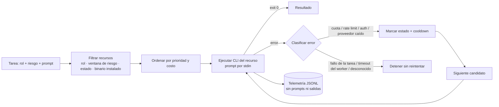

# VilTech AI Router

> A stdlib-only Python CLI that routes coding tasks across local AI CLIs (Codex, OpenCode, Antigravity) by role, risk and cost, failing over only on provider/quota errors — never on task failures.

**Estado:** MVP funcional

## Qué problema resuelve

Trabajo con varias CLIs de IA, cada una con cuotas, costos y modelos distintos. Elegir a mano cuál usar y cambiar de proveedor cuando uno se queda sin cuota es lento y propenso a errores. Este router elige automáticamente el recurso (adapter + modelo) adecuado para cada tarea. Además protege los modelos premium para que solo se usen en tareas de alto riesgo.

## Cómo funciona



Decisiones de diseño clave:

- **Granularidad por recurso (adapter + modelo), no por CLI.** Una misma CLI expone modelos con cuotas y riesgos distintos, así que el estado y el cooldown se llevan por modelo.
- **El failover ocurre solo ante fallas de infraestructura.** Si el error es de código o de tests, se detiene: reintentar con otro modelo ocultaría el problema real y gastaría cuota.
- **Las ventanas de riesgo protegen a los premium.** Las tareas low/medium nunca "se derraman" a modelos premium; las tareas high nunca bajan silenciosamente a un modelo más débil.
- **Privacidad por diseño.** El prompt se pasa por stdin (no por argv, que es visible en `ps`). En estado y telemetría solo se guardan nombre del recurso, categoría de error, duración y el nombre base del repo.
- **Solo biblioteca estándar** (`tomllib`, `argparse`, `subprocess`, `unittest`), así que no hay dependencias que auditar.

## Qué funciona hoy

Requisitos: Python 3.11+ y, para `run`, al menos una de las CLIs `agy`, `opencode` o `codex` instalada y autenticada.

```bash
python -m viltech_ai_router inventory --config router.toml        # lista recursos y si su CLI está instalada
python -m viltech_ai_router status --config router.toml           # estado y cooldown por recurso
python -m viltech_ai_router route --role coder --risk low --config router.toml   # dry-run: qué elegiría y por qué
python -m viltech_ai_router state-reset --resource agy_flash --config router.toml
python -m viltech_ai_router run --prompt-file task.txt --repo-dir /ruta/al/repo --role coder --risk low --config router.toml
```

- `inventory`, `status`, `route` y `state-reset` están verificados.
- Tests: `python -m unittest discover -s tests -v` → **11/11 pasan**. Cubren routing por riesgo y costo, la forma de los comandos de cada CLI, la clasificación de errores, la recuperación del cooldown, el failover, la privacidad de la telemetría y que no haya failover ante fallas de la tarea.
- `run` se probó en desarrollo con una tarea real enrutada a OpenCode/DeepSeek y con un E2E de proveedor falso: cuota agotada → un único fallback exitoso. **Ojo:** `run` llama a proveedores reales y consume cuota.
- `router.toml` refleja mi configuración local (modelos y prioridades). Ajústalo a las CLIs y modelos que tengas.

## Qué no funciona / quedó pendiente

- **No conoce la cuota restante.** Solo reacciona a los errores que reporta la CLI; no hay consulta proactiva de saldo.
- **La clasificación de errores usa regex sobre la salida de la CLI.** Si una CLI cambia sus mensajes, un error de cuota puede caer en `unknown_error` y no se hará failover.
- El estado `near_limit` está definido pero nunca se asigna (no hay señal de "casi agotado").
- Un timeout del proceso completo no se reintenta con otro modelo (es intencional: es ambiguo si la tarea quedó a medias). Esto implica que el reintento queda en manos del operador.
- No está empaquetado (no hay `pyproject.toml`): se ejecuta con `python -m` desde la raíz del repo.
- Probado principalmente en Linux/WSL; en Windows nativo corren los tests y los comandos de solo lectura.

## Qué aprendí

- Distinguir entre **fallas de infraestructura** y **fallas de la tarea** es la decisión central de un orquestador. Mezclarlas gasta cuota y esconde bugs.
- Pasar prompts por argv filtra su contenido a `ps`. Usar stdin es un cambio pequeño con mucho impacto en seguridad.
- Una revisión independiente hecha por otro modelo encontró 3 problemas HIGH antes del cierre. La revisión adversarial entre modelos vale la pena incluso en un MVP.
- Mantener el alcance acotado ("solo stdlib, sin cuota proactiva") permitió terminar un MVP usable en lugar de otra plataforma a medias.

## Stack

Python 3.11+ (solo stdlib) · TOML · JSONL · `unittest` · CLIs: Antigravity (`agy`), OpenCode, Codex

## Licencia

© 2026 Jhon Villegas — [AGPL-3.0](LICENSE). Para uso comercial bajo otros términos, contáctame.
